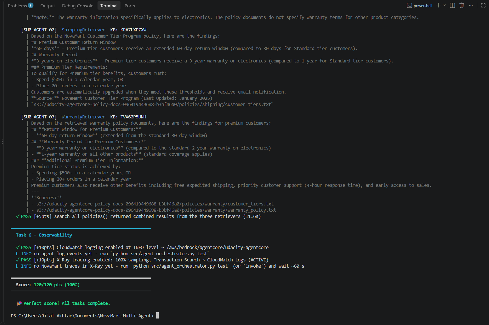
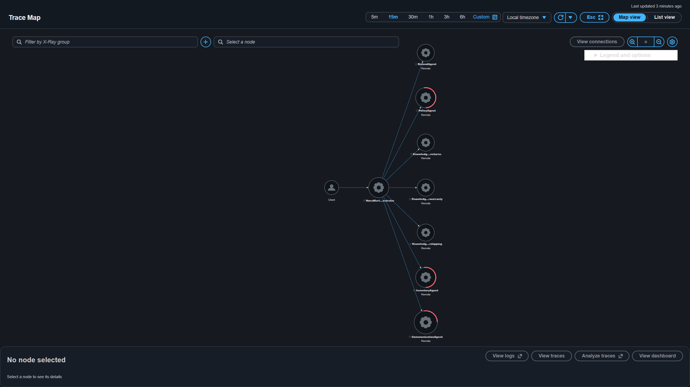

# NovaMart — Multi-Agent System with Amazon Bedrock AgentCore

**Udacity AI Agent Engineering · Capstone Project 3.3**  
**Automated assessment: 120/120 (100%) · Three successful end-to-end scenarios · AWS X-Ray distributed tracing**

NovaMart is an agent-based e-commerce customer support system built with **Strands Agents**, **Amazon Bedrock**, **AgentCore Runtime**, **Bedrock Knowledge Bases**, **DynamoDB**, and **AWS X-Ray**. A routing agent delegates customer requests to specialist agents for order lookups, refund eligibility, policy research, and customer-facing replies. The policy specialist queries three separate knowledge bases concurrently and synthesizes grounded findings.

> This is an educational capstone implementation with mock customer/order data, not a production customer-service deployment. The 120/120 result comes from the provided **local automated assessment**, not an official Udacity grading decision.

## Architecture


```text
Customer request
       |
       v
OrchestratorAgent — Claude Haiku 4.5
       |                (routing + session initialization)
       |
       +-- InventoryAgent — Claude Sonnet 4.5
       |      \-- DynamoDB: order details and customer tier
       |
       +-- PolicyAgent — Claude Sonnet 4.5
       |      |-- ReturnsPolicyRetriever  --> Returns Knowledge Base
       |      |-- ShippingPolicyRetriever --> Shipping Knowledge Base
       |      \-- WarrantyPolicyRetriever --> Warranty Knowledge Base
       |          (parallel ThreadPoolExecutor retrieval)
       |
       +-- RefundAgent — Claude Sonnet 4.5
       |      \-- eligibility and refund workflow
       |
       \-- CommunicationAgent — Claude Sonnet 4.5
              \-- final customer-facing response

Shared workflow state: DynamoDB + version-based optimistic locking
Safety: Bedrock Guardrails | Memory: AgentCore SESSION_SUMMARY (7 days)
Observability: CloudWatch Logs + X-Ray / CloudWatch Transaction Search
```


### Agent responsibilities

| Agent | Configured model | Main tools and behavior |
|---|---|---|
| **OrchestratorAgent** | Claude Haiku 4.5 (`config.ORCHESTRATOR_MODEL_ID`) | `initialize_session`; routes to Inventory, Policy, Refund, and Communication agents; delegates the final response |
| **InventoryAgent** | Claude Sonnet 4.5 (`config.WORKER_MODEL_ID`) | `check_order_status`, `get_customer_tier`, `list_customer_orders` |
| **PolicyAgent** | Claude Sonnet 4.5 | `search_all_policies`, coordinating three retriever agents |
| **RefundAgent** | Claude Sonnet 4.5 | `get_inventory_context`, `initiate_refund`; 30-day Standard and 60-day Premium return windows |
| **CommunicationAgent** | Claude Sonnet 4.5 | `get_full_workflow_context`; composes customer-facing messages |

The policy retrievers use `retrieve_from_knowledge_base()` with the respective Returns, Shipping, and Warranty KB IDs. Their requests run concurrently using `ThreadPoolExecutor(max_workers=3)` and `as_completed()`.

## What the project demonstrates

- **Multi-agent orchestration:** Specialized agents selected by customer intent; the CommunicationAgent produces the final response.
- **Parallel RAG:** Three synchronized Bedrock Knowledge Bases use `amazon.titan-embed-text-v2:0` embeddings and S3 Vectors indexes.
- **Shared state:** A DynamoDB `WorkflowState` record supports inter-agent handoffs with optimistic version checking.
- **Enterprise guardrails:** Content filters, PII handling, denied topics, profanity filtering, and a published guardrail version.
- **Session memory:** AgentCore `SESSION_SUMMARY` strategy with a seven-day event expiry.
- **Observability:** CloudWatch INFO logging and 100% X-Ray sampling in the learning environment, with recorded agent and Knowledge Base relationships.


## Verification and results

Run the project's complete assessment from the repository root:

```powershell
uv run python tests/test_agent.py all
```

| Assessment | Result |
|---|---:|
| Task 2 — Multi-Agent Orchestration | 40/40 |
| Task 3 — AgentCore Runtime and Guardrails | 20/20 |
| Task 4 — AgentCore Memory | 15/15 |
| Task 5 — Knowledge Bases and parallel retrieval | 25/25 |
| Task 6 — CloudWatch and X-Ray configuration | 20/20 |
| **Total** | **120/120 (100%)** |



### End-to-end scenarios

The local end-to-end test completed all three coursework scenarios:

```powershell
uv run python src/agent_orchestrator.py test
```

| Scenario | Observed agent path | Outcome |
|---|---|---|
| Return wireless headphones for `CUST-001` | Orchestrator → Inventory → Refund → Communication | Retrieved the order and Premium tier; requested a return reason before initiating a refund |
| Premium return-policy question for `CUST-002` | Orchestrator → Policy → three parallel policy retrievers → Communication | Retrieved policy passages from all three KBs and explained the 60-day return window |
| Five items at $29.99 with a 10% discount for `CUST-003` | Orchestrator → Communication | Returned **$134.95** |

The test published **three X-Ray trace IDs**. The AWS Service Map subsequently displayed the connected orchestrator, worker agents, and Knowledge Base nodes required by the project rubric.



> **Trace scope:** This screenshot represents successful **local** test execution and published X-Ray segments. The earlier remote AgentCore Runtime invocation encountered an AWS Organizations / Marketplace authorization error. The local test later succeeded with the specified Claude models; do not interpret this as proof that the remote-runtime authorization issue was resolved.

## Getting started

### Requirements

- Windows PowerShell or a compatible shell
- Python **3.12** and [`uv`](https://docs.astral.sh/uv/)
- Node.js 20+ and npm AgentCore CLI (`@aws/agentcore`; v0.31.1 used for this project)
- An AWS account or course lab environment with suitable permissions for Bedrock, AgentCore, DynamoDB, S3, S3 Vectors, IAM, CloudFormation, CloudWatch, and X-Ray
- Model access to the configured Claude Haiku 4.5 and Sonnet 4.5 inference profiles

### Configure

```powershell
# Install Python dependencies from the supplied requirements file
uv pip install -r requirements.txt

# Install the CLI used for the deployment
npm install -g @aws/agentcore@0.31.1
agentcore.cmd --version

# Create a local configuration (PowerShell)
Copy-Item .env.example .env
```

Populate `.env` with the AWS resource IDs specific to **your own environment**. The three policy KBs must be created and synchronized against the project's S3 policies and S3 Vectors indexes; the supporting CloudFormation stack and seed script are in `infrastructure/`.

Example **variable names only** (do not use the lab's resource IDs in another AWS account):

```dotenv
AWS_REGION=us-east-1
PROJECT_NAME=udacity-agentcore
RETURNS_KB_ID=<your-returns-kb-id>
SHIPPING_KB_ID=<your-shipping-kb-id>
WARRANTY_KB_ID=<your-warranty-kb-id>
GUARDRAIL_ID=<your-guardrail-id>
GUARDRAIL_VERSION=<published-version>
AGENTCORE_RUNTIME_ARN=<your-runtime-arn>
```

> **Environment configuration and security:** This repository includes a populated `.env` containing eight project configuration variables: `AWS_REGION`, `PROJECT_NAME`, `RETURNS_KB_ID`, `SHIPPING_KB_ID`, `WARRANTY_KB_ID`, `AGENTCORE_RUNTIME_ARN`, `GUARDRAIL_ID`, and `GUARDRAIL_VERSION`. These identify the lab's AWS resources and are publicly visible; they are **not** authentication credentials. Do **not** commit AWS access keys, secret access keys, session tokens, passwords, or other sensitive values. `.env.example` provides a reusable template; replace the resource IDs with your own when deploying elsewhere.

### Deploy and test

The project defines its deployment workflow in `src/agent_orchestrator.py` and the AgentCore CLI configuration under `agentcore/`. The successful lab deployment used the npm AgentCore CLI, with memory and observability configured through their Python helper functions:

```powershell
agentcore.cmd deploy --yes
agentcore.cmd status

# Assessment
uv run python tests/test_agent.py all

# Live local scenarios (requires working Bedrock model access)
uv run python src/agent_orchestrator.py test
```

Deployment requires provisioned foundation resources, populated configuration, and the project-specific staging/setup steps described in the source and coursework. The automated tests verify the deployed infrastructure independently of these README commands.

## Repository guide

| Path | Description |
|---|---|
| `src/agent_orchestrator.py` | Agent builders, tools, routing, guardrails, deployment, memory, tracing, and local test scenarios |
| `src/agent_observability.py` | X-Ray and CloudWatch helper layer |
| `src/bedrock_kb_retrieval.py` | Bedrock KB retrieval integration |
| `src/agentcore_cli.py` | CLI deployment wrapper |
| `infrastructure/` | Foundation resources, seed data, and cleanup utilities |
| `agentcore/` | AgentCore Runtime/CDK project configuration |
| `tests/test_agent.py` | Local automated assessment suite |
| `diagrams/` | Architecture and request-flow diagrams |
| `screenshots/` | Genuine assessment and AWS X-Ray evidence |

## Operational notes

The original lab environment produced an AWS Organizations-level denial for Marketplace model subscriptions during **remote Runtime invocation**. Separately, the subsequent **local three-scenario test worked**, including Claude inference, parallel RAG, and trace publication. Access can therefore differ between execution contexts; check CloudWatch runtime logs and the account's Bedrock model permissions if a remote invocation fails.

The project's CloudWatch/X-Ray sampling is set to **100% for demonstration**; that setting and the AWS resource lifecycle should be reviewed before any production use. Keep cost controls in place and run the supplied infrastructure cleanup workflow only after required evidence has been preserved.

## References

- [Strands Agents SDK](https://github.com/strands-agents/sdk-python)
- [Amazon Bedrock AgentCore](https://docs.aws.amazon.com/bedrock-agentcore/latest/devguide/)
- [Bedrock Knowledge Bases](https://docs.aws.amazon.com/bedrock/latest/userguide/knowledge-base.html)
- [Amazon Bedrock Guardrails](https://docs.aws.amazon.com/bedrock/latest/userguide/guardrails.html)
- [AWS X-Ray](https://docs.aws.amazon.com/xray/latest/devguide/aws-xray.html)

---

## Submission Evidence — Udacity Project 3.3

The following evidence demonstrates the NovaMart multi-agent implementation, AWS deployment, and successful test execution.

### 1. Automated Assessment

**Score: 120/120 (100%)**

- [Full Automated Test Results](screenshots/NovaMart_120_120_Test_Results.png)

### 2. Amazon Bedrock Knowledge Bases

All three Knowledge Bases use Amazon Titan Text Embeddings V2 with Amazon S3 Vectors as the backing store.

| Knowledge Base | Configuration | Data Source Synchronization |
|---|---|---|
| Returns | [Embedding and S3 Vectors](screenshots/kb_return_emb.png) | [Sync Results](screenshots/kb_returnsync.png) |
| Shipping | [Embedding and S3 Vectors](screenshots/kb_shipping_emb.png) | [Sync Results](screenshots/kb_shippingsync.png) |
| Warranty | [Embedding and S3 Vectors](screenshots/kb_warranty_emb.png) | [Sync Results](screenshots/kb_warrantysync.png) |

Vector indexes: `returns-policy-index`, `shipping-policy-index`, and `warranty-policy-index`.

### 3. End-to-End Multi-Agent Testing

The following screenshots document execution of the customer-support test scenarios using `uv run python src/agent_orchestrator.py test`.

- [Return Request — Inventory Agent](screenshots/test1_return.png)
- [Refund Policy Processing](screenshots/test2_refundpolicy.png)
- [Communication Agent](screenshots/test3_commagent.png)
- [Policy Agent and Parallel RAG](screenshots/test4_policyagent.png)
- [Policy Response — Communication Agent](screenshots/test5_communcationagent.png)
- [Discount Calculation](screenshots/test6_communcationagent_calculation.png)
- [Policy Answer](screenshots/test7_policyanswer.png)

### 4. AWS X-Ray Distributed Tracing

- [AWS X-Ray Service Map](screenshots/NovaMart_XRay_ServiceMap.png)

The Service Map demonstrates the NovaMart-Orchestrator connected to worker agents and Knowledge Base retrieval components.

---

